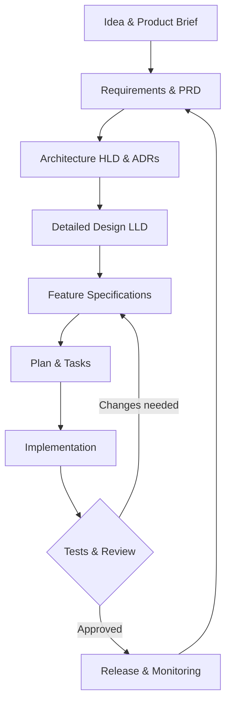

# SPECTION

**AI-Guided Software Engineering Framework**

> Specify. Architect. Build. Validate. Evolve.

SPECTION is an open-source, technology-agnostic framework to guide developers through the entire software development lifecycle using **Spec-Driven Development (SDD)**, **Harness Engineering**, reusable **Agent Skills**, traceable documentation and human-reviewed quality gates.

**Author:** Alexsand Farias de Souza · **License:** MIT · **Status:** v0.2 foundation (documentation and offline CLI, not yet a hosted application).

## How it works



## Core principles

1. **Specification before implementation.** Do not invent product requirements.
2. **Human control.** Get approval for high-impact decisions, destructive actions and production release.
3. **Traceability.** Link requirements to decisions, tasks, tests and evidence.
4. **No fabricated verification.** Never claim a test passed without executing it.
5. **Security and privacy by design.** Never commit secrets or sensitive personal data.
6. **Vendor independence.** Use any language, stack, IDE or compatible AI agent.
7. **Reviewable change.** Record substantial design decisions with ADRs.

## Quick start

1. Complete [Product Brief](docs/product-brief.md) and [PRD](docs/prd.md).
2. Document [HLD](docs/hld.md), [LLD](docs/lld.md), and [ADRs](docs/adr/0001-template.md).
3. Copy the [feature template](specs/_template/feature-spec.md) into a numbered feature folder.
4. Load [AGENTS.md](AGENTS.md) into your AI coding agent.
5. Follow the skills in [`.agents/skills/`](.agents/skills/) and the corresponding prompts.
6. Run the project's real tests; record evidence and obtain human review before release.

## Repository layout

- `docs/`: reusable product, architecture and traceability templates
- `specs/_template/`: feature specifications, plans and tasks
- `.agents/skills/`: role-oriented agent instructions
- `prompts/`: guided workflows for project setup and features
- `.github/workflows/`: automated Markdown structure checks

## SPECTION Kit — executable toolkit

The [SPECTION Kit](kit/README.md) adds a local, standard-library Python CLI, guided software-engineering workflows, architecture references, security/ethics templates and tests.

```bash
git clone https://github.com/alexsandsouza/spection.git
cd spection
python kit/spection.py init my-app
python kit/spection.py doctor my-app
python kit/spection.py feature my-app account-login
python kit/spection.py check my-app
```

Learn from the [practical user guide](kit/docs/user-guide.md), inspect the [AI architecture diagram](kit/docs/architecture.md), review the [security and ethics guide](kit/docs/security-ethics.md), and select a [workflow](kit/workflows/README.md). The CLI works offline, creates local files only, and never invokes AI APIs or deploys your application. Checks are structural, not a substitute for functional tests or specialist audits.

## Why SPECTION?

Build software around validated market needs, not generated code alone. SPECTION connects product discovery, architecture, implementation and verification. Reusable specifications and skills can reduce repeated context setup, ambiguity and rework; measure actual delivery time, defect rates and costs rather than assuming a guaranteed speedup.

## How to develop faster with AI

Start with a small, valuable feature. Define acceptance criteria before coding; give your agent the approved context and relevant skill; ask for a bounded implementation plan; run real tests; review the evidence. Reuse the same process for features, bug fixes and releases.

Read the [developer guide and worked example](docs/developer-guide.md).

## Documentation hub

| Guide | Purpose |
|---|---|
| [Framework guide](docs/framework-guide.md) | Lifecycle, harness engineering, roles and review gates |
| [Developer guide](docs/developer-guide.md) | Installation, practical example, productivity and existing projects |
| [SPECTION Kit](kit/README.md) | CLI, workflows and templates |
| [AI reference architecture](kit/docs/architecture.md) | Optional models, agents, RAG and gateway |
| [Responsible development](docs/responsible-development.md) | Market alignment, security, ethics and privacy |
| [Model evaluation](kit/docs/model-evaluation.md) | Quality, latency, cost and safety |
| [Português](docs/README.pt-BR.md) | Guia de utilização em português |

## Copyright, license and attribution

Copyright (c) 2026 Alexsand Farias de Souza. SPECTION is released under the [MIT License](LICENSE), allowing use, modification and distribution, including commercial use, subject to retaining the copyright and permission notice. See [Copyright and Attribution](COPYRIGHT.md) for third-party licensing, contributions, AI-assisted material and trademark guidance.

SPECTION is an independent project inspired by established software engineering practices and GitHub Spec Kit. It is not an official GitHub product or endorsed implementation.

## Scope and limitations

SPECTION is a **starter framework**: documentation, agent guidance and an offline CLI. It is not a deployed web platform, and its Markdown checks are not a substitute for executable tests or a security assessment.

## Contributing

Read [CONTRIBUTING.md](CONTRIBUTING.md). All contributions must respect the MIT license and the project's human-review and evidence standards.

## Portuguese

**SPECTION** é um framework aberto de engenharia de software orientada por especificações e guiada por IA. Comece pelo Product Brief, detalhe os requisitos, documente a arquitetura, defina tarefas e execute testes verificáveis antes de entregar.
