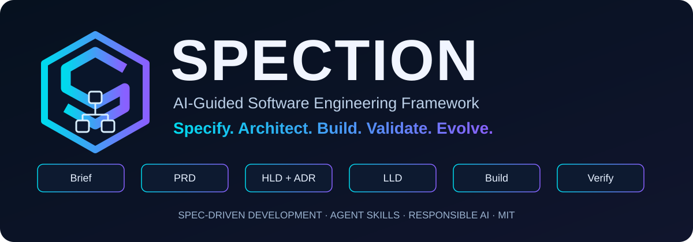
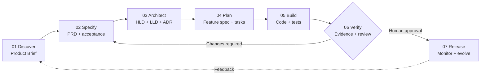
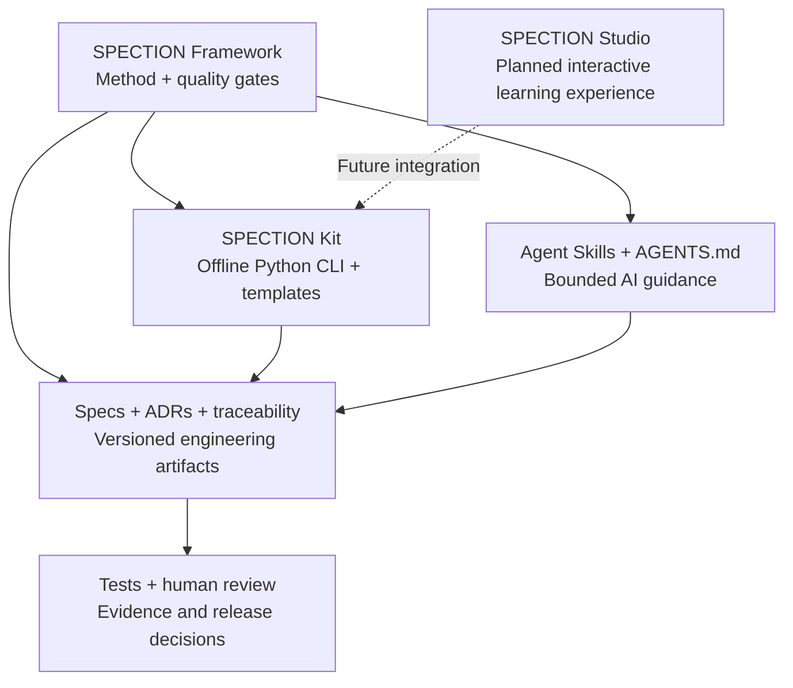

<div align="center">



# SPECTION
### From validated ideas to verifiable software.

**An open-source, vendor-neutral framework for specification-driven, AI-assisted software engineering.**

[](LICENSE)


**[🌐 Website](https://alexsandsouza.github.io/spection/)** · **[🚀 Get started](kit/README.md)** · **[📘 Documentation](docs/framework-guide.md)** · **[🇧🇷 Português](docs/README.pt-BR.md)**

</div>

---

> **Specify → Architect → Build → Validate → Evolve.**  
> AI accelerates work; people remain accountable for decisions, verification and release.

SPECTION connects **Spec-Driven Development (SDD)**, **Harness Engineering**, reusable **Agent Skills**, traceable artifacts and human-reviewed quality gates. It supports conventional software and AI-enabled applications without locking teams into a specific model, editor or programming language.

### Explore SPECTION

| Explore | Learn | Build | Trust |
|:--|:--|:--|:--|
| [Official portal](https://alexsandsouza.github.io/spection/) | [Framework concepts](docs/framework-guide.md) | [SPECTION Kit](kit/README.md) | [Responsible AI](docs/ethical-use.md) |
| [Roadmap](docs/roadmap.md) | [Developer manual](docs/developer-guide.md) | [Practical examples](examples/README.md) | [Security & privacy](kit/docs/security-ethics.md) |
| [Português](docs/README.pt-BR.md) | [Glossary](GLOSSARY.md) | [Agent Skills](.agents/skills/) | [License & attribution](COPYRIGHT.md) |

## Why SPECTION?

Code generation alone does not validate a product idea, clarify ambiguous requirements or prove that software works. SPECTION gives teams a repeatable route from **problem → specification → architecture → implementation → evidence**.

- **Specification first:** define the problem, measurable outcomes and testable acceptance criteria before coding.
- **Human control:** require approval for consequential decisions, destructive actions and production release.
- **Traceability:** link requirements, decisions, tasks, tests and actual evidence.
- **No fabricated verification:** never claim a test passed without running it.
- **Security and privacy by design:** keep secrets and sensitive information out of commits and unapproved model contexts.
- **Vendor neutrality:** use compatible agents, languages, IDEs and deployment environments.
- **Reviewable changes:** record meaningful design trade-offs in ADRs.

## The seven-stage workflow



| Stage | Key question | Artifact / quality gate |
|---|---|---|
| **01 Discover** | What problem matters, and for whom? | Product Brief; problem and scope validated |
| **02 Specify** | What must the system do? | PRD; testable RF/RNF and acceptance criteria |
| **03 Architect** | How will we design it responsibly? | HLD, LLD, ADRs; trade-offs reviewed |
| **04 Plan** | What should be implemented next? | Feature spec, plan and bounded tasks |
| **05 Build** | Does implementation follow the approved spec? | Code, tests and reviewable changes |
| **06 Verify** | What evidence demonstrates correctness? | Real test results, traceability, security review |
| **07 Release** | Is delivery approved and reversible? | Release notes, rollback, monitoring, human approval |

The workflow is **iterative, not a mandatory waterfall**. Small changes can use lightweight documentation; higher-risk changes require deeper review.

## Quick start - offline, without API keys

**Requirements:** Git and Python 3.10 or newer.

```bash
git clone https://github.com/alexsandsouza/spection.git
cd spection
python kit/spection.py init my-app
python kit/spection.py doctor my-app
python kit/spection.py feature my-app account-login
python kit/spection.py check my-app
```

The CLI creates and checks **local files only**. It does **not** call AI APIs, execute your project's functional tests, or deploy software. Its checks are structural and do not replace specialist security reviews.

### Guided implementation with AI

1. Complete the [Product Brief](docs/product-brief.md) and [PRD](docs/prd.md).
2. Record [HLD](docs/hld.md), [LLD](docs/lld.md) and [ADRs](docs/adr/0001-template.md).
3. Copy the [feature specification template](specs/_template/feature-spec.md) into a numbered feature folder.
4. Provide [AGENTS.md](AGENTS.md), approved specs and the relevant [Agent Skills](.agents/skills/) to your coding assistant.
5. Request a bounded plan before implementation; review incremental changes.
6. Run real tests, preserve evidence and obtain human approval before release.

**[Kit user guide](kit/docs/user-guide.md)** · **[Workflows](kit/workflows/README.md)** · **[Architecture reference](kit/docs/architecture.md)**

## The SPECTION ecosystem



| Component | What exists today |
|---|---|
| **Framework** | Methodology, lifecycle, templates and quality gates |
| **Kit** | Local Python CLI, scaffolding, structural checks and workflows |
| **Agent Skills** | Reusable guidance for AI coding assistants |
| **Documentation portal** | Public website and guides |
| **Studio** | **Planned**, not yet available as an interactive application |

## Learn by building

| Path | Focus | Start |
|---|---|---|
| **Booking API** | Requirements, transactions and concurrency | [Conventional application](examples/README.md#1-booking-api-conventional-software) |
| **AI document assistant** | RAG, permissions and model evaluation | [AI application](examples/README.md#2-ai-document-assistant) |
| **Existing application** | Incremental SDD adoption without a rewrite | [Brownfield workflow](examples/README.md#3-existing-application) |

Explore the [examples catalog](examples/README.md) and the [worked developer guide](docs/developer-guide.md).

## Documentation hub

| Resource | Purpose |
|---|---|
| [Framework guide](docs/framework-guide.md) | Lifecycle, roles, harness engineering and gates |
| [Developer manual](docs/developer-guide.md) | Practical implementation and productivity |
| [Kit](kit/README.md) | Commands, templates and local checks |
| [Reference AI architecture](kit/docs/architecture.md) | Optional models, agents, RAG and gateways |
| [Responsible development](docs/responsible-development.md) | Market alignment, security, ethics and privacy |
| [Model evaluation](kit/docs/model-evaluation.md) | Quality, latency, cost and safety |
| [Portuguese guide](docs/README.pt-BR.md) | Complete getting-started guide in PT-BR |

## Repository map

```text
spection/
├── .agents/skills/       # Reusable AI agent instructions
├── .github/workflows/    # Repository automation
├── assets/brand/         # Brand identity
├── docs/                 # Product, architecture and governance
├── examples/             # Learning paths
├── kit/                  # Offline CLI, workflows and checks
├── prompts/              # Guided prompts
├── site/                 # Next.js documentation portal
├── specs/_template/      # Feature specs, plans and tasks
├── AGENTS.md             # Agent operating guidance
└── README.md             # Project overview
```

## Roadmap

- **Foundation (v0.2):** documentation, offline CLI, templates, examples and portal.
- **Documentation experience:** bilingual navigation, clearer diagrams and visual onboarding.
- **SPECTION Studio (planned):** interactive seven-stage walkthrough and a beginner portfolio project.
- **Future integrations (proposals):** artifact export, traceability visualization and optional AI/GitHub integrations.

Track proposed work in the [roadmap](docs/roadmap.md). A roadmap item is not a shipped capability.

## Responsible engineering

SPECTION prioritizes human accountability, accessibility, privacy, security, fairness, transparency and intellectual property. Review foreseeable harms, enforce least privilege and measure actual outcomes. **AI output is a draft until verified.**

Read the [ethical use guide](docs/ethical-use.md), [responsible development](docs/responsible-development.md) and [security guidance](kit/docs/security-ethics.md).

### Scope and limitations

SPECTION v0.2 is a **starter framework with documentation, agent guidance and an offline CLI**. The public website is a documentation portal, **not a hosted software-building platform**. Markdown checks do not establish functional correctness, compliance or security certification. Potential productivity gains should be measured, not assumed.

## Contribute

Contributions, examples and constructive feedback are welcome. Read [CONTRIBUTING.md](CONTRIBUTING.md) and submit focused changes with acceptance criteria and reproducible evidence.

## Author, license and attribution

**Alexsand Farias de Souza** - university professor, Full Stack developer and creator of SPECTION.

[Portfolio](https://alexsandsouza.github.io/) · [GitHub](https://github.com/alexsandsouza) · [LinkedIn](https://www.linkedin.com/in/alexsandfarias)

Copyright © 2026 Alexsand Farias de Souza. Licensed under [MIT](LICENSE); retain copyright and permission notices when reusing the project. See [COPYRIGHT.md](COPYRIGHT.md) for attribution, AI-assisted content and third-party guidance.

SPECTION is an independent project informed by established software engineering practices and GitHub Spec Kit. **It is not an official GitHub product or endorsed implementation.**

---

<div align="center">

**Build deliberately. Verify with evidence. Evolve responsibly.**

[Back to top](#spection) · [Português (Brasil)](docs/README.pt-BR.md) · [Official website](https://alexsandsouza.github.io/spection/)

</div>

## SPECTION Academic Lab

Follow the [Academic Lab](lab/README.md), a demonstrative project with a documented first feature and actual local test evidence. Staged inside this repository pending separate repository creation. [Live Project](https://alexsandsouza.github.io/spection/#live-project).
