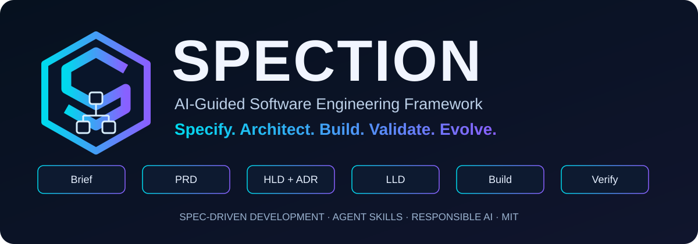
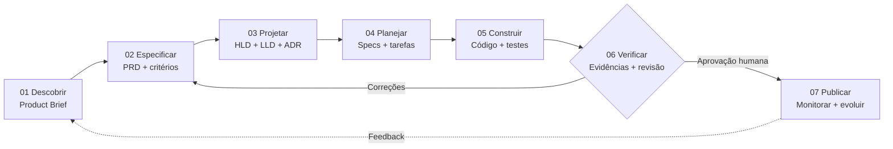
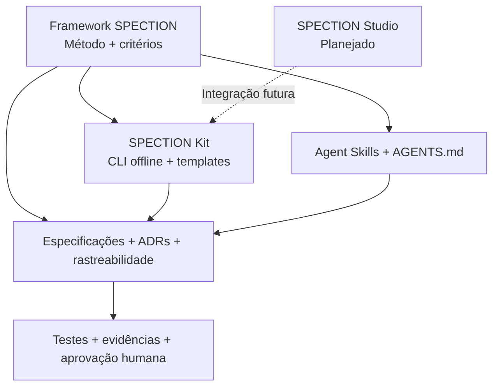

<div align="center">



# SPECTION
### Da ideia validada ao software verificável.

**Framework de código aberto para engenharia de software orientada por especificações, com apoio de IA e supervisão humana.**

[](../LICENSE)


**[🌐 Site oficial](https://alexsandsouza.github.io/spection/)** · **[🚀 Começar](../kit/README.md)** · **[📘 Documentação](framework-guide.md)** · **[🇺🇸 English](../README.md)**

</div>

---

> **Especificar → Projetar → Construir → Verificar → Evoluir.**  
> A IA auxilia o desenvolvimento; pessoas continuam responsáveis pelas decisões, verificações e entregas.

O **SPECTION** integra **Spec-Driven Development (SDD)**, **Harness Engineering**, **Agent Skills**, documentação rastreável e critérios de qualidade revisados por pessoas. É independente de fornecedor, linguagem, IDE ou modelo de IA.

## Navegação

| Conhecer | Aprender | Construir | Responsabilidade |
|---|---|---|---|
| [Portal](https://alexsandsouza.github.io/spection/) | [Fundamentos](framework-guide.md) | [SPECTION Kit](../kit/README.md) | [Uso ético](ethical-use.md) |
| [Roadmap](roadmap.md) | [Manual prático](developer-guide.md) | [Exemplos](../examples/README.md) | [Segurança e privacidade](../kit/docs/security-ethics.md) |
| [English](../README.md) | [Glossário](../GLOSSARY.md) | [Agent Skills](../.agents/skills/) | [Licença e autoria](../COPYRIGHT.md) |

## Por que utilizar o SPECTION?

Gerar código não significa validar uma ideia, eliminar ambiguidades ou comprovar que um sistema funciona. O SPECTION conecta **problema, requisitos, decisões arquiteturais, tarefas, implementação e evidências**.

Os princípios são: **especificar antes de implementar; manter o controle humano; rastrear decisões e testes; não inventar resultados; proteger dados e segredos; preservar a independência tecnológica; e registrar decisões arquiteturais relevantes.**

## As sete etapas



| Etapa | Objetivo | Entregável / critério |
|---|---|---|
| **01 Descobrir** | Compreender problema, usuários e objetivos | Product Brief validado |
| **02 Especificar** | Definir requisitos e critérios verificáveis | PRD, RF/RNF e critérios de aceitação |
| **03 Projetar** | Avaliar arquitetura, riscos e alternativas | HLD, LLD e ADRs revisados |
| **04 Planejar** | Organizar incrementos e dependências | Especificação, plano e tarefas |
| **05 Construir** | Implementar mudanças delimitadas | Código e testes revisáveis |
| **06 Verificar** | Executar testes e registrar evidências reais | Rastreabilidade e revisão de segurança |
| **07 Publicar** | Autorizar entrega, reversão e monitoramento | Release e aprovação humana |

O processo é **iterativo**, não uma sequência rígida. Alterações pequenas podem usar documentação enxuta; mudanças críticas exigem análise mais profunda.

## Comece em poucos comandos

**Pré-requisitos:** Git e Python 3.10 ou superior. Sem chave de API e sem serviço pago obrigatório.

```bash
git clone https://github.com/alexsandsouza/spection.git
cd spection
python kit/spection.py init minha-app
python kit/spection.py doctor minha-app
python kit/spection.py feature minha-app cadastro
python kit/spection.py check minha-app
```

O Kit gera e verifica **arquivos locais**. Ele **não** chama APIs de IA, não publica automaticamente o sistema e não substitui testes funcionais ou auditorias de segurança.

### Da especificação ao código

1. Preencha o [Product Brief](product-brief.md) e o [PRD](prd.md).
2. Documente [HLD](hld.md), [LLD](lld.md) e [ADRs](adr/0001-template.md).
3. Utilize o [template de funcionalidade](../specs/_template/feature-spec.md).
4. Forneça [AGENTS.md](../AGENTS.md), documentos aprovados e [Agent Skills](../.agents/skills/) ao assistente de programação.
5. Solicite um plano antes do código; implemente mudanças pequenas e revisáveis.
6. Execute testes reais, registre evidências e obtenha aprovação humana antes da publicação.

[Guia do Kit](../kit/docs/user-guide.md) · [Workflows](../kit/workflows/README.md) · [Arquitetura de referência](../kit/docs/architecture.md)

## Ecossistema SPECTION



**Disponíveis atualmente:** metodologia, documentação, portal, Kit Python, templates, workflows e Agent Skills. **Planejado:** SPECTION Studio, uma experiência interativa de aprendizagem e desenvolvimento. Não se trata de uma funcionalidade já publicada.

## Aprenda com exemplos

- [API de agendamentos](../examples/README.md#1-booking-api-conventional-software): requisitos, transações e concorrência.
- [Assistente de documentos com IA](../examples/README.md#2-ai-document-assistant): RAG, permissões e avaliação.
- [Aplicações existentes](../examples/README.md#3-existing-application): adoção incremental do SDD.

Consulte o [catálogo de exemplos](../examples/README.md) e o [manual de desenvolvimento](developer-guide.md).

## Biblioteca de documentação

| Material | Finalidade |
|---|---|
| [Guia do framework](framework-guide.md) | Ciclo de vida, papéis e qualidade |
| [Manual do desenvolvedor](developer-guide.md) | Exemplo prático e implementação |
| [SPECTION Kit](../kit/README.md) | Comandos, templates e verificações |
| [Arquitetura de IA](../kit/docs/architecture.md) | Modelos, agentes, RAG e gateway opcionais |
| [Desenvolvimento responsável](responsible-development.md) | Mercado, privacidade, ética e segurança |
| [Avaliação de modelos](../kit/docs/model-evaluation.md) | Qualidade, latência, custo e segurança |
| [Glossário](../GLOSSARY.md) | Termos técnicos |
| [Direitos autorais](../COPYRIGHT.md) | Licenciamento e atribuição |

## Estrutura do repositório

```text
spection/
├── .agents/skills/       # Instruções para agentes
├── .github/workflows/    # Automação
├── assets/brand/         # Identidade visual
├── docs/                 # Documentação e governança
├── examples/             # Exemplos práticos
├── kit/                  # CLI e workflows offline
├── prompts/              # Prompts guiados
├── site/                 # Portal Next.js
├── specs/_template/      # Templates de funcionalidades
└── AGENTS.md             # Orientações aos agentes
```

## Evolução do projeto

- **Base v0.2:** documentação, Kit offline, templates, exemplos e portal.
- **Experiência documental:** navegação bilíngue, diagramas e integração visual.
- **Studio (planejado):** tutorial interativo das sete etapas, começando por um portfólio.
- **Integrações futuras (propostas):** exportação de artefatos, rastreabilidade visual e integrações opcionais com IA e GitHub.

Acompanhe o [roadmap](roadmap.md). Itens planejados não são recursos disponíveis.

## Segurança, ética e limites

Não compartilhe segredos ou dados pessoais com modelos sem autorização e controles adequados. Revise permissões, dependências, acessibilidade, privacidade, riscos e impactos. Em sistemas com IA, avalie também qualidade, custo, latência, prompt injection e limites de ferramentas.

O SPECTION v0.2 é um **framework inicial com documentação, orientação para agentes e CLI offline**. O site público é um portal de documentação, não uma plataforma hospedada de construção de software. Verificações estruturais não comprovam conformidade, correção funcional ou segurança. Ganhos de produtividade devem ser medidos.

Leia [uso ético](ethical-use.md), [desenvolvimento responsável](responsible-development.md) e [segurança](../kit/docs/security-ethics.md).

## Contribuições

Sugestões e contribuições são bem-vindas. Consulte [CONTRIBUTING.md](../CONTRIBUTING.md). Envie mudanças pequenas, critérios de aceitação e evidências reproduzíveis.

## Autor, licença e atribuição

**Alexsand Farias de Souza** - professor universitário, desenvolvedor Full Stack e criador do SPECTION.

[Portfólio](https://alexsandsouza.github.io/) · [GitHub](https://github.com/alexsandsouza) · [LinkedIn](https://www.linkedin.com/in/alexsandfarias)

Copyright © 2026 Alexsand Farias de Souza. Distribuído sob a [Licença MIT](../LICENSE), que exige a preservação dos avisos de copyright e permissão. Consulte [COPYRIGHT.md](../COPYRIGHT.md) para informações sobre terceiros e atribuição.

O SPECTION é um projeto independente, inspirado em práticas consolidadas de engenharia de software e no GitHub Spec Kit. **Não é um produto oficial do GitHub nem uma implementação endossada.**

---

<div align="center">

**Desenvolva com intenção. Verifique com evidências. Evolua com responsabilidade.**

[Voltar ao início](#spection) · [English](../README.md) · [Site oficial](https://alexsandsouza.github.io/spection/)

</div>
