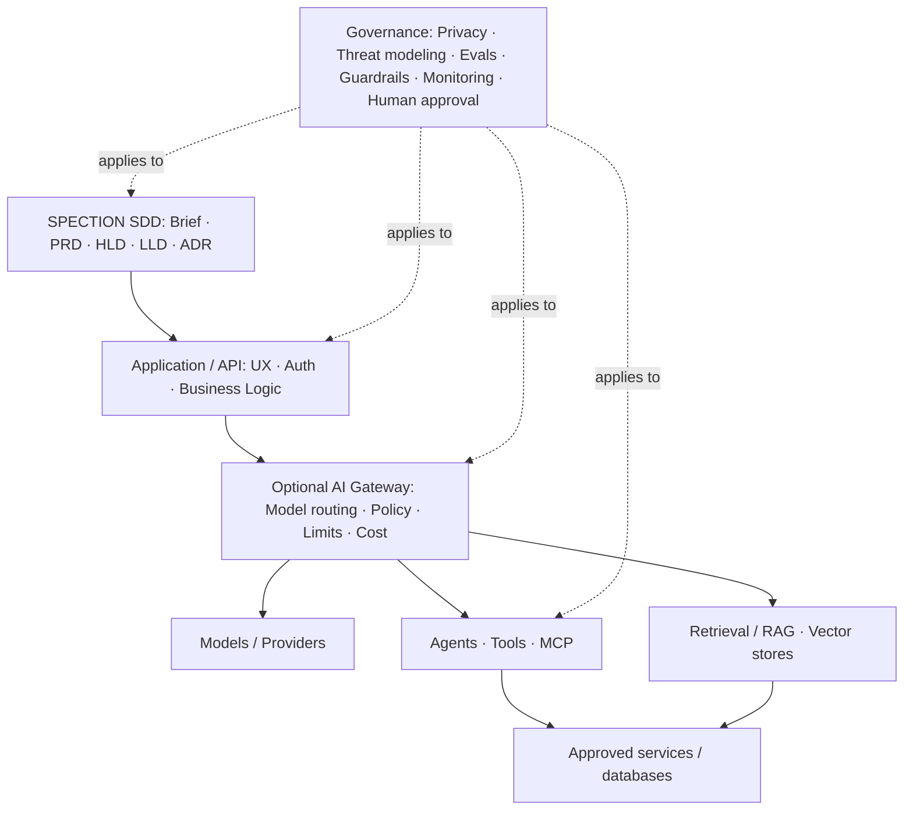

# SPECTION Architecture Reference

This diagram is a proposed **reference architecture**, not a requirement for every application. AI gateway, agents and vector search are optional.

## Layers

| Layer | Responsibility | Optional? |
|---|---|---|
| SDD and review | traceability, specs, architecture decisions, approval | No |
| Application | user experience, business rules, authentication, access control | Depends on system |
| AI Gateway | model routing, quotas, logging hygiene, rate limiting | Yes |
| Models and agents | generation, planning, retrieval, supervised tools | Yes |
| Data | SQL/NoSQL/vector stores selected by real access patterns | Yes |
| Governance | privacy, security, evaluation and accountability | No |

## Architecture decision process

First document business and quality requirements, then compare alternatives in an ADR. Evaluate latency, availability, security, lock-in, accessibility, cost and operational complexity. Do not select vector databases, cloud providers or agents solely because they are popular.

## AI system considerations

Apply least privilege to tools, treat retrieved and model-generated data as untrusted, constrain network and filesystem access, separate user instructions from retrieved documents, log safely and require explicit approval for external side effects.

## Relationship to HLD and LLD

HLD answers what services exist and how they communicate; LLD defines endpoint contracts, data schema, error cases and implementation rules; ADR records why design choices were made.
