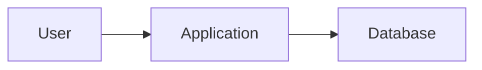

# High-Level Design (HLD)

**Status:** Draft - not approved

## Context and boundaries
[Users, components, external systems, trust boundaries]

## Proposed diagram

## Quality trade-offs
[Security, latency, cost, scalability and availability]

## Decisions and dependencies
[Link ADRs and approved requirements]
